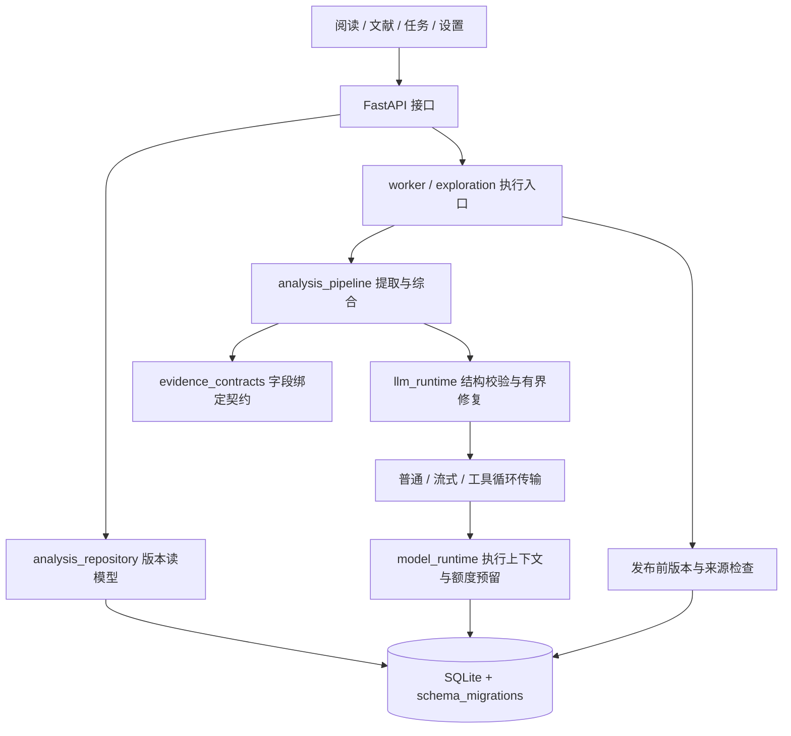

# Research Atlas 0.2.0 架构升级

日期：2026-09-30。数据库结构版本：3。质量契约版本：1。

本次升级将日常分析流程、证据绑定、版本查询、模型调用计量和存储迁移拆成独立边界。现有文献、分析、笔记与任务记录保留；旧结果按兼容读模型展示，不批量改写或重新付费生成。

## 模块与依赖方向

| 边界 | 责任 |
| --- | --- |
| `backend/analysis.py` | 兼容现有调用者，提供模型适配器与 PDF 解析入口 |
| `backend/analysis_pipeline.py` | 注入模型与进度回调，完成提取、引文核验、证据约束综合；不直接发布文献库 |
| `backend/evidence_contracts.py` | 定义字段到结论的引用关系、综合校验和保守质量状态 |
| `backend/analysis_repository.py` | 优先选择当前版本、缓存配置指纹、来源时效判断和发布冲突检查 |
| `backend/model_runtime.py` | 跨 API/worker/脚本的执行标识、持久计量与原子预留 |
| `backend/model_usage.py` | 不含密钥与论文正文的预算及用量 API |
| `backend/migrations.py` | 顺序、带校验和、可回滚的结构迁移 |
| `web/app/JobsPage.tsx` | 任务页查询、控制和有针对性的缓存失效 |
| `web/app/ModelBudgetSettings.tsx` | 显式保存调用预算，区分已报告用量与预留估计 |
| `web/AnalysisQuality.tsx` | 通过服务端规范质量契约展示核验范围 |

## 证据与结果契约

新的日常分析版本为 `evidence-v10-grounded-presentation`。分段缓存版本也已改变，避免把旧的无绑定输出直接用作新版结果。

1. 分段提取中的每条主引文及补充引文必须能在指定页定位。
2. 未通过引文定位的结论不会进入全文综合；同批生成的自由摘要、方法和问题也不会被无条件带入综合。
3. 综合输入只含有效结论。每个摘要单元、分类、方法和问题都声明 `claim_indices`，且引用必须属于最终选择的结论集合。
4. 结果编译为兼容原界面的字符串/数组，同时保留稳定 claim ID 与 `grounding` 映射。
5. 非综合调用只保留显式绑定且全部引用有效的字段；缺少绑定时从有效结论确定性生成摘要/方法，不复用无依据的原摘要。
6. 发布前重新检查论文版本、分类版本及解析来源。暂停/取消检查点也在提交前执行。

`quality` 分别表达引文定位、字段绑定、语义复核和版本时效。引文存在与字段绑定不证明科学结论正确。当前自动分析保持 `semantic=not_reviewed`。历史记录的模型名称或自由质量标记不会被解释成正式语义审阅通过；需要后续明确的审阅契约才能提升该状态。

来源修订保存不可变 `source-redirect`，并记录论文版本。旧修订缺少完整跳转历史时，利用当前版本 PDF 与其来源修订记录确定解析 hash；原始解析快照保持不变。

分类/方法过滤改用按论文 ID 关联的 `EXISTS`。两个过滤条件仍必须来自同一条当前论文/分类版本的分析；不会把不同领域或不同分析的标签拼在一起。此前仅按版本关联的 `IN` 子查询会为每篇论文重建领域匹配 ID 集合；新增规模测试同时检查查询计划及 SQLite 指令量，防止重新引入这种扫描。

## 用量与预算

所有三种付费传输入口都在每次实际 HTTP 尝试前预留额度：普通 DeepSeek、流式研读和来源工具循环。API、worker 与独立脚本共享 SQLite 用量表。

- 追踪标识：`job_id`、`paper_id`、`run_id`、`stage`。嵌套校验、修复与语义复核继承上下文。
- 上限：`daily_tokens`、`task_tokens`、`task_calls`，可设正整数或 `null`；默认不设上限，以兼容原配置。
- 任务按 job ID 累计，恢复同一任务不会清零。独立研读按持久执行目录标识累计。
- 每日边界使用北京时间；Windows 缺少 IANA 时区数据时回退到 UTC+8。
- 预留按消息 UTF-8 长度、协议余量及输出上限保守估计，不能视为实际 token 或账单金额。
- 使用服务商报告结算；无效 JSON、截断或内容校验失败仍记录已报告用量。
- 超时、用量缺失等未知结果保留额度。配置 token 上限后，未知用量会阻止相关预算范围的后续调用；暂无人工核销接口。
- 已确认的鉴权、配额等非生成拒绝释放 token 预留，但实际 HTTP 尝试仍计入调用次数上限。
- 原子 `BEGIN IMMEDIATE` 在读预算之前取得写锁，防止多个进程同时超额准入。缓存复用不产生新计费请求。

API：`GET /api/model-usage`、`GET/PUT /api/model-usage/budget`；结构状态：`GET /api/architecture`。

## 数据库升级与恢复

启动时统一运行迁移。版本 1 接管旧增量列，版本 2 增加分析与队列索引，版本 3 纳入模型用量表及必需列。账本校验失败、结构漂移或数据库比程序更新时拒绝启动。升级失败整体回滚，不重建业务表。

`python -m scripts.atlas_backup --output <新备份路径>` 使用 SQLite backup API，适用于已提交的活动 WAL。目标存在时拒绝覆盖。`--verify <备份路径>` 可只读验证。该工具只备份数据库；PDF、上传文件、解析快照及加密密钥文件应按既有完整 data 备份约定保存。恢复说明见 `storage-upgrade.md`。

## 验收与边界

程序测试覆盖证据污染隔离、无效字段绑定、单段综合、缓存配置变化、连续来源修订、过期提交、版本迁移、并发额度竞争和未知用量保护。浏览器测试覆盖阅读、数学/PDF、任务控制、预算显式保存和窄屏布局。

最终验证：后端 280 项通过；浏览器 126 项通过，无跳过、失败或不稳定项；TypeScript 检查与生产构建通过。保留现有 Vite 大块提示和上游 TestClient 弃用提示，未将提示隐藏。

隔离性能测试使用 10,000 条文献、1,000 条分析，每条路线 100 次请求、并发 5。列表 p95 193.90ms、关键词检索 568.15ms、概览 12.58ms、分类过滤 140.90ms。测试为进程内 ASGI，不含网络、浏览器或 PDF 解析负载；完整结果见 `benchmark.json`。

升级在正式库副本上先演练，再启动正式实例：254 篇论文、870 份分析、1 条笔记与 457 条任务记录逐行内容哈希保持一致，后台暂停与模型关闭控制保持一致。迁移不将旧内容自动标为新版核验通过。源码与迁移前数据库快照保存在本次 Codex 工作目录 `work`；附件仍保留在原项目 data 下。

代表性真实论文的科学准确性仍需要单独审阅。本次不调用真实模型，不把实验性深度研读编译器宣称为已达标，也不接入自动批量发布。数据库仍为个人单机 SQLite；没有将系统迁移到多租户或分布式服务。App 的部分领域控制器及全局失效逻辑仍保留，按后续具体修改逐步抽离。

正式实例已启动并报告版本 0.2.0 / 结构版本 3，后台仍暂停、模型仍关闭、模型账本 HTTP 尝试数为 0。最后加入的分类查询优化需在下一次正常重启后加载；本次 API 单独重启被工具的自动审批拒绝，返回 `blocked by policy`，未给出更具体原因。可通过项目已有的 Stop / Start Research Atlas.cmd 完成正常重启。
