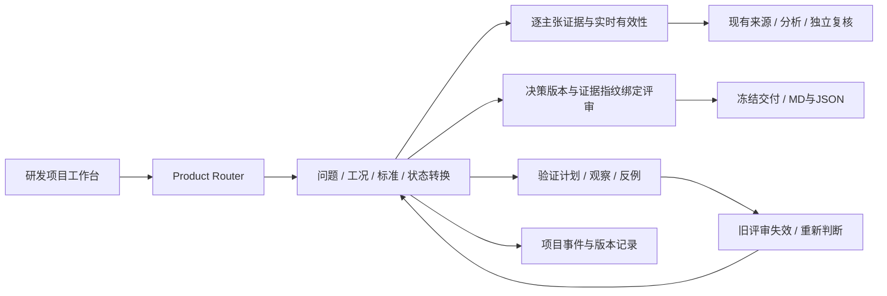

# Research Atlas 0.3：研发决策产品域

2026-10-21。本轮把个人文献工作台扩展为企业研发试点。以具体研发问题及决策档案为产品对象，复用现有文献证据资产。市场定位和验证实验见[商业化策略](commercialization-strategy.md)，已运行检查和验收步骤见[交付验证](commercial-verification.md)。

## 模块与依赖

保持模块化单体，新增 `backend/product`。项目聚合目前对应一个决策课题，未来确有多课题需求再拆分Project/Case。没有重复建设分析流水线、模型预算或引文校验。

| 边界 | 责任 |
| --- | --- |
| `product/contracts.py` | 场景、评价标准、长度与空白校验；不接收伪造的原文引文 |
| `product/models.py` | Project、Evidence、Review、Delivery、Validation、Event与独立修订的Candidate、TrendLead表 |
| `product/service.py` | 证据有效性、标准覆盖、评审指纹、冻结交付 |
| `product/research_flow.py` | 候选筛选、论文反向项目关联与跨项目失效依据投影 |
| `product/trend_leads.py` | 从已有趋势重建预览、核对来源指纹、冻结方向或单篇焦点及候选映射 |
| `product/paper_intakes.py`、`product/intake_runtime.py` | 原项目收录记录、固定来源与版本、任务共享、定向下载及按需分析执行、结果回填 |
| `product/router.py` | 事务、revision、对象归属、只读检索与导出 |
| `web/product` | 显式保存、来源阻断、409保留输入、验证反馈与交付下载 |
| `migrations.py` | 迁移4加入项目核心表；5加入验证反馈；6加入候选清单；7加入趋势来源线索；8加入论文收录记录；既有迁移不改写 |

service通过 `analysis_repository` 和既有独立复核契约读取文学证据，不调用模型。写入在同一 `BEGIN IMMEDIATE` 内校验revision、来源和评审，保存业务状态与事件。GET不因浏览创建项目、启动任务或调用模型。

当前候选方案、工况适用性和决策建议由使用者明确填写；不会自动生成材料配方或假装完成数值工况对齐。变化复审在读取、评审与交付时检查已有文库变化，不包含新的外部定时监测服务。

2026-10-24补充：文献候选以独立修订号和发现快照记录取舍，位于正式证据及交付指纹之外。论文库、阅读器与项目以真实地址互相定位，标准覆盖表保留有效正反证、待核依据及内部验证的区别。影响清单基于实时来源质量与身份字段，不解析中文提示来推断类别。使用方法与验收见[论文筛选与证据核对](project-research-flow.md)。

趋势方向及单篇样本现可保存为项目线索：来源由服务器从已有缓存重建、核对指纹，并与关注理由、候选映射分开保存。冻结快照不接受客户端任意引文；来源更新或范围切换不静默更换已有记录。取舍独立修订，位于决策评审与交付指纹之外。未入库的外部样本只保留出处，不自动建立论文候选或正式依据。

## 证据与决策契约

服务器从已有Analysis选择一个claim，保存analysis_id、paper_id、领域、论文/分类版本、content_hash、原始主张摘要哈希、页码和引文。用户填写项目标准、立场与工况适用性，不能提交任意原文来伪造绑定。

研究阶段允许收集待核或历史证据；评审和交付均在服务端检查引文核验、字段绑定、独立语义复核和版本当前性。新分析、解析源修订、分类变化、证书失效或原主张被篡改都会阻止沿用旧依据。旧快照保持原样，用户重新选择并判断适用性，不能静默用新结果覆盖旧决策。

每个标准至少有一条有效依据；反对证据允许并保留，待核立场需要明确处理。该门禁保证流程一致性，不证明证据充分、因果成立或适用于真实工况。评审指纹包括决策字段、证据快照、实时质量及验证记录；修改建议、替换证据、回写实验结果都使旧评审失效。

## 交付和反馈

交付冻结问题、工况、标准、建议、未知项、证据、评审与内部验证记录。MD便于阅读，JSON便于版本核对；不打包论文PDF，长引文明确节选。已有交付只读，后续变化形成新版本。同一有效评审在当前revision下再次交付返回已有记录；过期revision返回409。内容SHA256用于完整性核对，不是组织身份认证或法律电子签章。

内部验证计划记录负责人、测试条件与通过标准；完成需实际观察和支持/反对/不确定结果。内部记录始终标注未独立核验，不能升级成论文证据。事件保留验证前后值、移除前的证据快照、决策修改前后值；这用于本机过程追踪，不宣称防篡改外部审计系统。

## 商业部署关卡

当前为本机单组织可信环境。项目ID是业务归属，`X-Atlas-Client`是本机请求保护，负责人/评审署名是手工标签；都不是租户隔离或可信认证。现有全局Settings、Domain、Paper与文件接口不能直接暴露给公网客户。

共享部署的P0顺序：

1. OIDC/组织成员与服务端权限；统一覆盖所有API、下载、检索和模型设置。
2. 公共文献和私有资料分层；数据库、文件、缓存、队列、向量索引与导出必须一致隔离，不能只给新表加tenant_id。
3. 内容许可、留存/删除、加密、备份恢复与附件导出策略。
4. job attempt、租约/fencing、幂等发布、恢复语义，之后扩多worker；再评估PostgreSQL、对象存储和独立检索。现有SQLite迁移不能靠环境变量直接换数据库。
5. 项目成本归因、价格版本、席位/用量权益。复用token原子预留，但预留量不等于真实费用或客户账单。
6. 请求链路、SLO、告警和发布回滚；模型run/job/stage与产品事件只是基础。

本轮不添加未接服务的SSO、支付或授权按钮，不联系外部客户，也不恢复暂停任务。

## 验证与切换

集成测试使用真实构建的独立复核证书夹具，验证无复核/伪claim/过期来源阻断、并发冲突、跨项目对象、编辑和内部反例使评审失效、交付幂等及旧内容不可变。迁移覆盖v3→[4,5]、v4→[5]、账本/表漂移及旧数据保留。

隔离E2E覆盖模板到交付、移动端/reduced-motion、浏览无写入、真实后端质量阻断与409输入保留。截图为测试数据，不是客户验证成果。

升级前以SQLite backup API形成一致数据库快照，再在独立副本演练迁移4/5。演练前后旧论文、分析、笔记、任务、设置和用量表指纹一致；备份只覆盖数据库，附件不因本次增量迁移改动。正式实例只启动API，不启动worker。结果记录于 `work/commercial-20261021`；其中数据库备份可能含凭据，不作为公开演示附件。

## 趋势样本收录执行边界（迁移8）

新增 `ProjectPaperIntake` 独立修订记录，以项目、原趋势线索、规范论文编号和领域约束重复收录。`product/paper_intakes.py`负责归属、revision、共享任务认领、结果发布与真实分析回写；API内定向执行器只执行本功能关联且获 `intake_scope` 授权的任务，不启动全局worker。追加迁移8建立新表，既有迁移保持不变。

原TrendLead判断快照与候选映射、项目业务revision、证据指纹和旧交付不因收录任务变化。新记录分别冻结发起判断、官方元数据、PDF版本/哈希/身份核对和分析目标。下载发布通过事务及执行所有权校验补充领域归属与候选，已有论文同版本人工修订和候选理由保留；分析完成仅在真实当前Analysis符合目标版本时回写，不以Job完成代替分析成功。

下载按规范论文编号及请求版本跨项目、跨领域共享；分析复用仍核对领域、来源、分类与模型身份。失败仅由显式重试重新排队，暂停任务不自动恢复。全局暂停下，新明确请求创建的任务可保存显式授权并运行，不修改全局开关、不给复用旧任务补授权、不复活历史暂停任务；后续pause/cancel及执行fencing继续生效。模型开关、密钥、预算、PDF身份与版本检查不能被显式授权绕过。收录和分析不会代替独立证据复核或放宽项目交付门禁。

本轮后端全量379项、浏览器回归36项、TypeScript及生产构建通过；最后样式/提示修订后收录后端23项与趋势/收录/任务浏览器17项复测通过。真实API和执行器的隔离验收覆盖PDF校验、来源不变、共享任务、候选自动回填及390px排版；源响应使用测试替身，无外网/模型调用。正式API已应用迁移8，备份演练及正式旧表指纹核对通过，模型和历史任务状态不变。详见[本轮操作与验收记录](project-research-flow.md#趋势外部样本收录与按需分析迁移8)。此前章节的迁移与验收数字为各轮历史记录。
