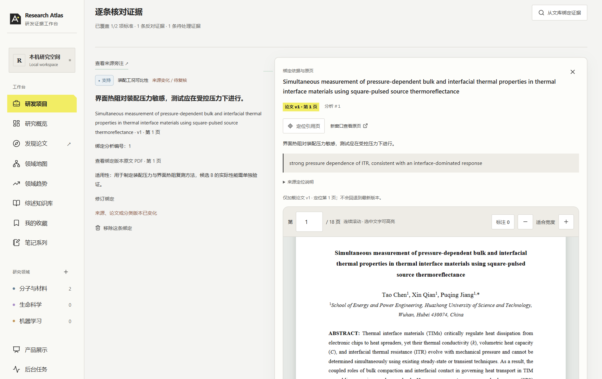
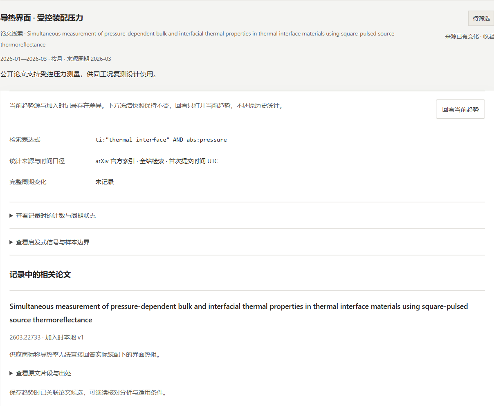
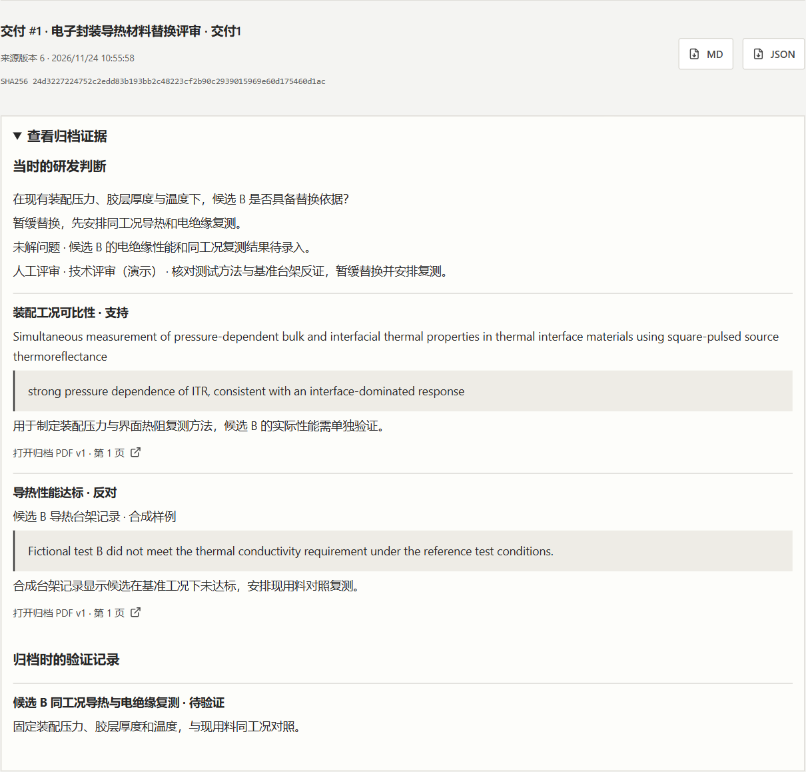
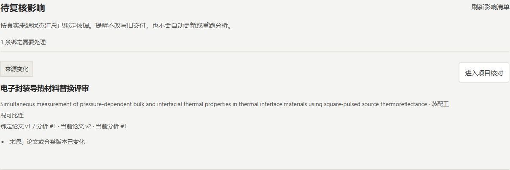

# ResearchAtlas 产品展示与验收

产品页首屏展示真实工作台的原文核对界面。下面的三组图文分别展示趋势线索、可复核的交付与来源变更影响。页面以应用截图和用户收益介绍产品，按需打开独立的互动案例。这一内容结构参考了 [Zotero 官网](https://www.zotero.org/) 的整页应用截图和按能力分区。

## 展示入口

在竞赛分支执行 `npm ci` 和 `npm run build`。用工作台服务或静态服务器从 `dist` 根路径提供页面，访问 `/showcase/`。工作台侧栏也有「产品展示」。点击截图可查看原尺寸。点击「体验材料评审」进入 `/showcase/?view=demo#demo`。产品页与交互回放可以使用静态服务器。「打开工作台」入口需要配套服务。

截图均取自生产构建启动的实际工作台，使用隔离材料评审数据。其中公开论文 PDF 原页、冻结档案详情与版本影响清单由应用服务读取。候选材料、台架数据、评审署名和验证计划为演示记录。

## 产品界面

**判断和原文在同一页。** 评审人查看主张、适用性和绑定版本，同时打开论文原页。

**研究线索能回到原始语境。** 项目保存文献的研究窗口、版本和关注理由。

**归档保留了当时的决定。** 下一位评审人可以看到反证、原页和当时还没完成的验证。

**来源变化有明确的复核范围。** 影响清单定位到所用论文版本和对应的评审标准。

## 现场走查

| 阶段 | 操作 | 验收证据 |
| --- | --- | --- |
| 发现线索 | 检索「装配压力与界面热阻」，展开历史线索，收录并关联 v1 | 第一条候选展示匹配与受控测量依据。关联后显示线索编号、论文版本与收录理由 |
| 核对原页 | 展开方法依据和台架反证，打开固定版本原页，再逐条采纳 | 公开论文定位到 arXiv v1 第 1 页，合成台架记录定位到本站 PDF 第 1 页。电绝缘作为替换前的待验证项保存 |
| 安排验证 | 记录「暂缓替换，安排同工况复测」 | 页面展示评审前后的决定、执行人、对照工况、通过条件和待录入状态 |
| 归档交付 | 记录人工复核，冻结交付，下载 Markdown，再点回归档引用的论文 | 档案 RA-TIM-R04 保留署名、理由、验证任务、论文版本、页码和采纳记录 |
| 来源复核 | 回放 v2 发布事件，打开版本对照，加入复核清单 | 受影响范围是「装配工况可比性」，归档仍指向 v1。重新下载得到相同内容 |
| 无匹配恢复 | 选择「候选 B 的长期热老化结果」，然后调整检索 | 明示样例语料没有该候选的长期数据，并能通过键盘返回检索 |

工作台增加了「查看归档证据」。展开后按需读取冻结快照，在同一位置展示当时的建议、验证和版本原页。验证计划未执行时显示「待验证」。回看档案时不会写入项目。

## 资料与运行边界

- 即时体验回放已知历史资料。检索范围和排序理由只对应样例候选。时间脉络取自 2007、2023、2026 年三项公开研究，不代表该领域的发文增长。[2007 测量方法](https://arxiv.org/abs/0709.1849) [2023 导热胶实验](https://doi.org/10.3390/polym15143083)
- Tao Chen 等的论文在 2026 年 3 月 24 日发布 v1，3 月 30 日发布 v2。v2 摘要对脂类材料本体热学性质加入测量不确定度的限定。公开 PDF 直接指向 arXiv 的版本锚点。[论文 v1](https://arxiv.org/pdf/2603.22733v1#page=1) [论文 v2](https://arxiv.org/pdf/2603.22733v2#page=1)
- 候选 B、台架记录、人员、评审与替换决定属于模拟案例。回放不读写生产库，也不触发云端模型。打开公开原页需要联网，站内合成台架 PDF 可独立打开。
- 正式云端联调依赖比赛账号开通。按 [AgentArts 联调手册](agentarts-runbook.md) 录制云端调用、工作流版本和运行记录。端到端的本机验收使用隔离环境。

## 验证

验收覆盖 390px 与桌面、键盘操作、减少动效、PDF 版本和页码、导出记录、归档快照和来源更新后的重下载一致性。测试可从 `tests/e2e/showcase.spec.ts` 和 `tests/e2e/projects.spec.ts` 复现。现场计时从首次进入案例到交付打开，人工对照尚待独立试用测量。本项目不据自动化耗时声称节省人工时间。
